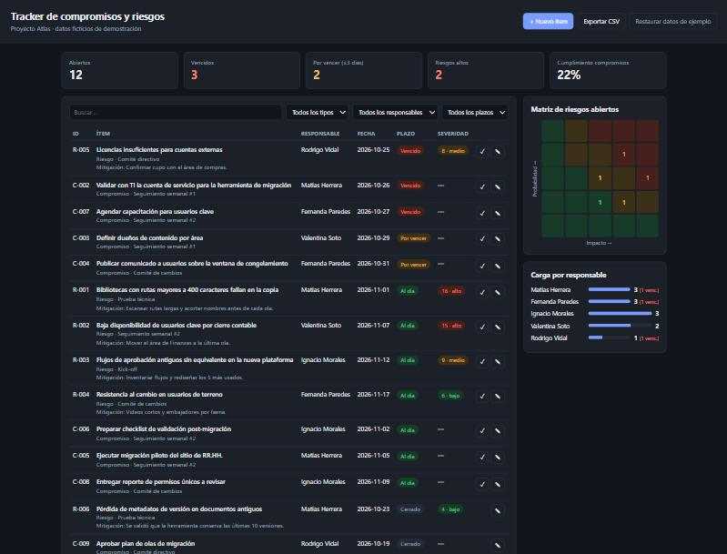
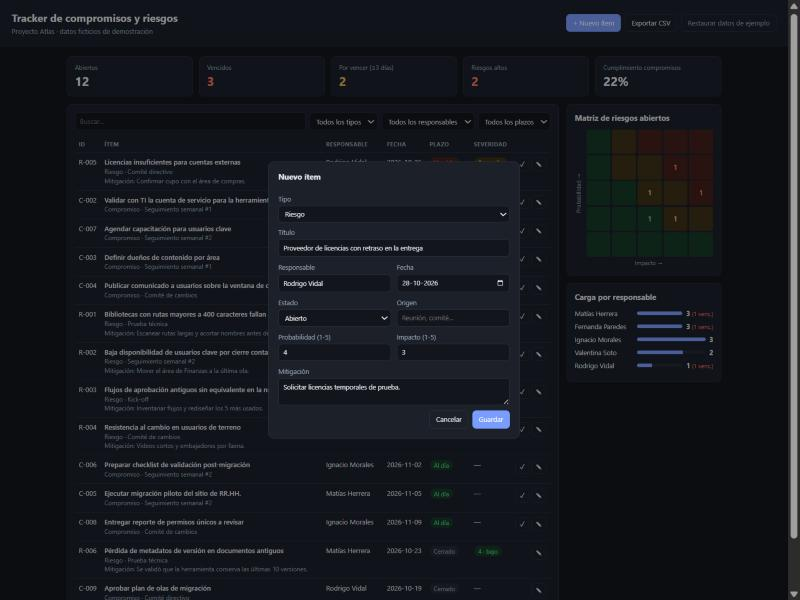

# Tracker de compromisos y riesgos

Tablero liviano para seguir los **compromisos** que salen de las reuniones de un proyecto y sus **riesgos**, con semáforo de plazos, matriz de probabilidad × impacto y carga por responsable.

**[Ver demo en vivo](https://alansch7.github.io/tracker-compromisos-riesgos/)**

> Todos los datos son **ficticios**: el "Proyecto Atlas" es la migración de la intranet de una empresa inventada (Empresa Demo S.A.). Ninguna persona, área ni fecha corresponde a un proyecto real.



## El problema

En los proyectos con muchas reuniones de seguimiento, los compromisos quedan repartidos entre actas, correos y planillas. Nadie ve con claridad qué está vencido ni quién está sobrecargado, y los riesgos se registran una vez y no se vuelven a revisar. Este tracker los junta en un solo lugar y responde lo que importa en cada reunión: **qué hay que destrabar hoy y quién lo tiene**.

## Qué hace

- **KPIs**: ítems abiertos, vencidos, por vencer (≤ 3 días), riesgos altos y % de cumplimiento de compromisos.
- **Lista priorizada**: primero lo vencido, luego lo que vence pronto, luego los riesgos más severos. Se puede filtrar por tipo, responsable, plazo y texto libre.
- **Matriz de riesgos 5×5** con los riesgos abiertos de cada celda (pasa el mouse para ver los IDs).
- **Carga por responsable**, para detectar a quién se le está acumulando trabajo.
- Alta y edición de ítems con validación, cierre en un clic y **exportación a CSV** (abre directo en Excel).

## Cómo usarlo

No necesita instalación ni build. Abre `index.html` en el navegador, o publícalo con GitHub Pages.

Los cambios quedan en el `localStorage` del navegador. El botón *Restaurar datos de ejemplo* vuelve al estado inicial.

```bash
npm test   # tests de la lógica (Node 18+), sin dependencias
```

## Decisiones de diseño

| Decisión | Por qué |
|---|---|
| **Compromisos y riesgos en una sola lista** | En la práctica se revisan juntos en la misma reunión de seguimiento. Tener un solo modelo con un campo `tipo` evita dos tableros que se desincronizan. |
| **Semáforo calculado, nunca guardado** | "Vencido" depende del día de hoy. Si se guardara, quedaría desactualizado al día siguiente. Solo se guardan la `fecha` y el `estado`. |
| **Severidad = probabilidad × impacto (1–5)** | Es la escala que la mayoría de los equipos ya conoce. Umbrales: ≥ 15 alto, ≥ 8 medio y el resto bajo. |
| **Orden por urgencia, no por ID** | La pregunta de la reunión es "¿qué tenemos que destrabar hoy?", no "¿qué se registró primero?". |
| **Lógica separada de la interfaz** | `src/logic.js` son funciones puras sin DOM: se testean en Node y se podrían reutilizar con otro frontend o backend. |
| **Sin frameworks ni backend** | Es una demo que debe abrirse con doble clic. `localStorage` alcanza para una persona. Para un equipo, el siguiente paso sería un backend compartido (por ejemplo, una hoja de cálculo o una API). |
| **Fechas de ejemplo relativas a hoy** | Así la demo siempre muestra una mezcla realista de vencidos, por vencer y al día, sin importar cuándo se abra. |

## Resultado

Con los datos de ejemplo (15 ítems), el tablero muestra al abrirlo 3 vencidos, 2 por vencer, 2 riesgos altos y un 22% de cumplimiento, sin que haya que filtrar ni ordenar nada. La carga por responsable deja ver que dos personas concentran los vencidos.



Las reglas de negocio están cubiertas por 9 tests automatizados: semáforo, severidad, validación, orden, filtros, indicadores, matriz y exportación a CSV.

## Estructura

```
index.html             interfaz
src/logic.js           reglas de negocio (puras, testeadas)
src/datos-ejemplo.js   datos ficticios
src/app.js             render, eventos y persistencia
src/styles.css         estilos (modo claro y oscuro)
tests/logic.test.js    tests con node:test
```

## Licencia

MIT
